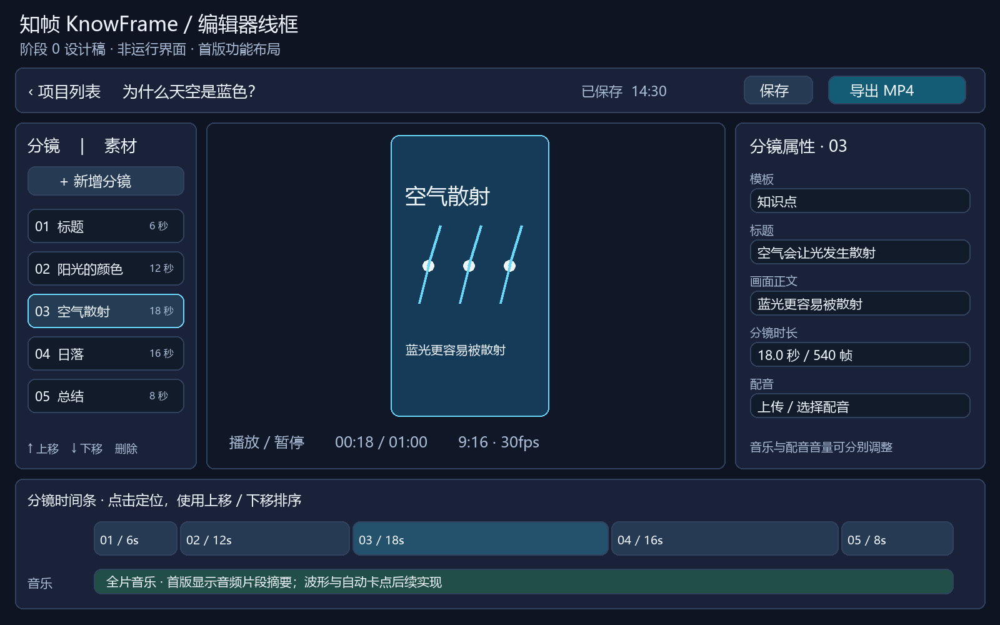

# 用户流程与界面

版本：0.1；日期：2026-11-03。状态：交互设计稿，不是已实现界面。

## 页面与路径

| 页面 | 规划路径 | 主要操作 |
| --- | --- | --- |
| 项目列表 | `/projects` | 新建项目，打开已保存项目；空态提示新建 |
| 编辑器 | `/projects/:id` | 分镜、素材、预览、属性、时间条、保存和导出 |
| 导出面板 | 编辑器内面板 | 查看任务状态、错误、重试、下载；打开项目后恢复未完成任务展示 |

首版可用同一入口实现项目列表与编辑器导航，不强制路由实现细节。

## 制作流程

1. 新建项目，创建服务端记录，进入空编辑器。
2. 添加标题分镜，编辑文字；继续添加知识点及总结。
3. 选择分镜上传图片，或从本项目素材中选择。
4. 选择分镜上传并关联配音；若时长不足，选择延长分镜。
5. 选择全片背景音乐并调整音量；点击播放开始试听。
6. 修改时长、顺序和模板，定位预览检查。
7. 点击保存，看到“已保存”和保存时间。
8. 点击导出；存在未保存修改时先提示“保存并导出”，保存失败不入队。
9. 显示排队/进度，成功后提供下载，失败后显示重试。
10. 返回项目列表后重新打开，恢复已保存文档并查询关联导出任务。

## 编辑器线框

项目列表及导出面板的低保真结构：

```text
项目列表
┌───────────────────────────────────────────────────────┐
│ vibe知识大赏                              + 新建项目  │
│ 项目名称                       最后保存时间    打开   │
│ 为什么天空是蓝色？             2026-11-03      打开   │
│ 空态：还没有项目，创建第一条知识视频                   │
└───────────────────────────────────────────────────────┘

编辑器内的导出面板
┌───────────────────────────────────────────────────────┐
│ 导出任务  ·  项目版本 revision 2                       │
│ 1080 × 1920 / 30fps / MP4                             │
│ 状态：排队 → 执行中（进度）→ 成功（下载）              │
│                          ↘ 失败（原因、重试）         │
│ 未保存修改：先显示“保存并导出”                         │
└───────────────────────────────────────────────────────┘
```



图中时间、按钮和分镜是布局示意；音乐波形、智能卡点和完整多轨拖拽不会在首版伪装为可用功能。

```text
┌─────────────────────────────────────────────────────────────────┐
│ 返回项目  项目名称           未保存/保存中/已保存     保存   导出 │
├──────────────┬─────────────────────────────┬────────────────────┤
│ 分镜 | 素材  │                             │ 当前选中分镜        │
│ 新增分镜     │        9:16 视频预览         │ 模板、标题、正文    │
│ 分镜列表     │                             │ 图片、配音、时长    │
│ 项目内素材   │ 播放/暂停  定位  当前/总时长 │ 音量及校验反馈      │
├──────────────┴─────────────────────────────┴────────────────────┤
│ 分镜时间条：点击定位，选中后前后移动                              │
│ 音频摘要：每分镜配音 + 一条全片音乐                              │
└─────────────────────────────────────────────────────────────────┘
```

## 主要交互约定

- 点击分镜同步选中属性并定位到该分镜首帧；播放过程中更改选择不修改时长。
- 第一版排序采用上移/下移按钮；时间条先提供选择与定位，复杂拖拽后续开发。
- 无选中分镜时属性区展示项目音乐；选中时展示当前分镜属性。
- 删除已关联素材的分镜需确认；素材记录保留，可再次使用。
- 文字超限阻止提交；潜在排版溢出显示预览警告，不能仅凭字符数判断适配。
- 导出任务展示所用 revision，继续编辑时显示“当前编辑已不同于该导出版本”。
- 所有尚未实现的后续能力不显示可点击入口；若需介绍，明确标记“规划中”。

## 状态与恢复

| 对象 | 状态 | 界面与恢复 |
| --- | --- | --- |
| 项目 | 加载中/空/正常/加载失败 | 骨架、添加首镜提示、编辑区、重试入口 |
| 保存 | 未保存/保存中/已保存/失败/冲突 | 失败保留编辑；冲突提示保留本地内容并重新打开服务端版本，不自动覆盖 |
| 上传 | 未开始/上传中/处理中/就绪/失败 | 进度、探测状态、可用素材卡、失败原因与重试 |
| 预览 | 待播放/播放/缓冲/素材缺失 | 显示加载状态；缺失素材定位到分镜，修复后恢复 |
| 导出 | 排队/执行中/成功/失败 | 进度、下载或重试；重复点击提交期间禁用 |

## 可用性要求

首要验收尺寸为 1440 × 900；在 1280 × 720 下允许面板内滚动，关键操作可达。窄屏提示使用桌面设备。表单有文本标签，图标按钮有名称，焦点可见，状态不只用颜色表达。预览保持比例缩放，不改变视频画幅。
