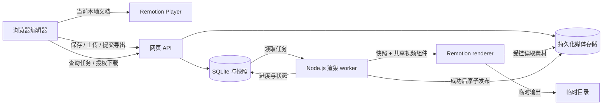

# 技术架构

版本：0.1；日期：2026-11-03。状态：阶段 0 设计基线，尚未初始化应用或锁定依赖。

## 起步技术决策

| 层 | 默认选择 | 边界 |
| --- | --- | --- |
| 网页与普通 API | Next.js + React + TypeScript，Node.js 运行时 | 编辑界面、文件上传、项目 CRUD、任务查询 |
| 视频 | Remotion + Player + renderer | 共享组件，浏览器预览，服务端生成 MP4 |
| 编辑状态 | 单一编辑文档与显式操作，轻量状态容器按需选择 | 本地编辑和服务端 revision 分开，不提前引入协同编辑 |
| 数据 | 单机 SQLite + 迁移文件 | 项目 JSON、素材元数据、任务及不可变快照；先不部署分布式数据库 |
| 文件 | 持久化数据目录 + StorageAdapter | 本地与服务器采用相同相对存储键；后续可换对象存储 |
| 渲染 | 独立 Node.js worker，同仓库部署 | 轮询持久任务表，初始同时执行 1 个导出任务 |
| 部署 | Linux 单服务器为设计目标，可使用容器 | 具体镜像、版本、容量及入口配置实施时确定 |

这些选择用于让阶段 1 可以直接开始，用户后续约束可通过 [决策记录](decisions/0001-single-server.md) 调整。暂不购买 Editor Starter，不绑定云服务和 AI 提供商。

## 数据流

## 模块与边界

- `src/editor/`：编辑操作、选择状态、未保存状态和预览参数适配。
- `src/remotion/`：composition、三类模板、共享时间计算；不访问数据库。
- `src/lib/`：帧转换、文档校验等可复用纯逻辑。
- `src/types/`：文档及 API 契约类型。
- 阶段 1 再增加 `src/app/`、服务端存储模块和 worker 入口，避免本阶段创建空实现。
- `ProjectDocument → validate → resolveAssets → CompositionProps` 是预览和导出共用的转换边界。

## 保存与素材

编辑器维护本地 dirty 文档。保存携带 baseRevision，服务端在事务中校验版本、写入文档并递增 revision。409 冲突不覆盖任一方内容。第一版不提供自动合并。

素材先上传到服务端暂存区，校验类型及配额、探测元数据后标记 ready，再允许关联。存储键由服务端生成，不保存开发者绝对路径或浏览器 blob URL。客户端通过受控媒体端点读取，并支持音频 Range 请求。

渲染 worker 使用服务端签发的短期任务凭证访问快照所引用的素材；凭证不进入项目 JSON 或日志。内部服务地址与公开地址分别配置，容器内不把宿主机 localhost 当作通用地址。素材 ID 必须属于该工作空间及项目。

## 导出任务

1. 用户先保存，再提交 expectedRevision 与幂等键。
2. API 在事务内校验 revision、素材就绪及总时长，冻结项目、素材清单及模板构建版本。
3. 任务进入 queued；worker 原子领取，持有 lease 与 heartbeat；同时处理一个任务。
4. 根据快照设置相同的画幅、帧率、时长和素材，渲染到任务临时目录。
5. 成功后原子发布完整文件，再标记 succeeded；失败输出不作为可下载结果。
6. 重启后回收过期 lease，标记失败并允许显式重试，避免永远停在 running。
7. 重试创建新任务并复用原快照；原模板构建版本不可用时明确失败，不悄悄换用新模板。

手动重试是第一版保证；自动重试、取消和分布式队列以后按需要加入。

## 服务器约束

网页和 worker 可同机运行，但为独立进程；SQLite 和媒体放持久卷，不放镜像或临时层。部署配置包含外部 URL、内部 URL、数据目录、并发、时限和上传限制。密钥仅服务端使用。

运行环境必须具备 Remotion 所需的无头浏览器依赖、媒体处理依赖和中文字体。浏览器端与渲染端使用同一套已固定的字体资源，避免字体回退导致换行差异。

公网发布前配置工作空间访问控制、HTTPS 和上传限制。用户输入不能指定任意服务端文件路径或渲染源代码。备份数据库、媒体和引用的模板构建版本；见 [部署文档](10-deployment.md)。

## 官方依据与待验证点

- [Remotion Player](https://www.remotion.dev/docs/player)：用于在 React 应用嵌入预览。
- [renderMedia](https://www.remotion.dev/docs/renderer/render-media)：程序化渲染，快照通过 inputProps 传入。
- [Docker 环境](https://www.remotion.dev/docs/docker)：说明浏览器及 Linux 系统依赖的准备。

2026-11-03 核对。具体 Node.js、Next.js、Remotion 版本在阶段 1 初始化时核查兼容性并提交锁文件；本阶段不声明已安装。服务器内存、导出时间、中文字体一致性和私有媒体访问需运行验证后才能给出结论。
